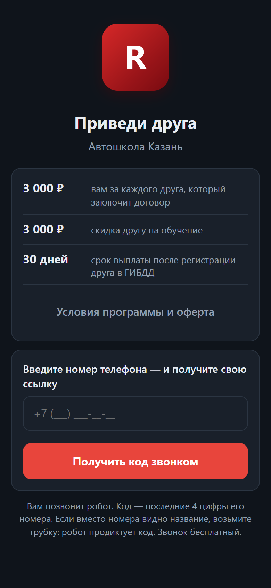
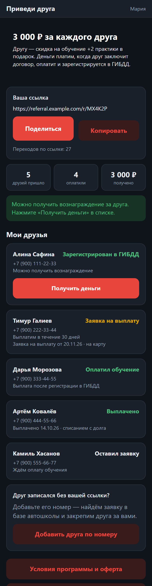
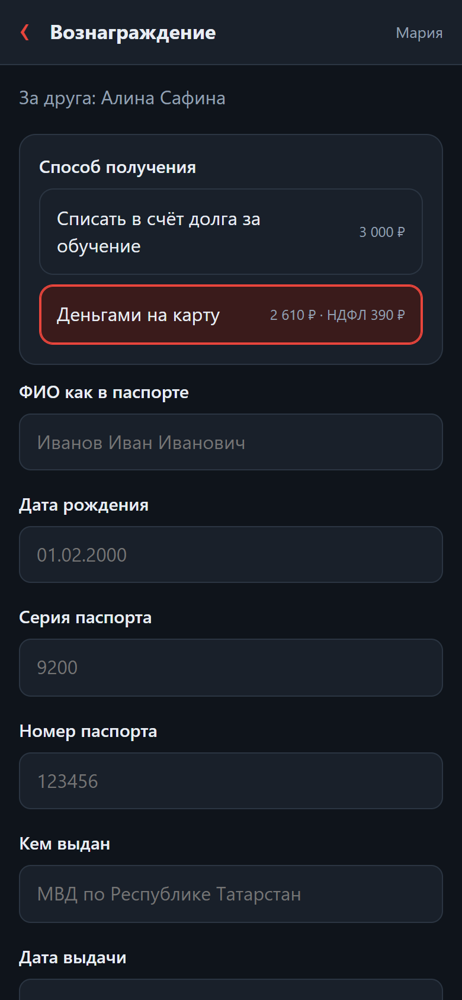
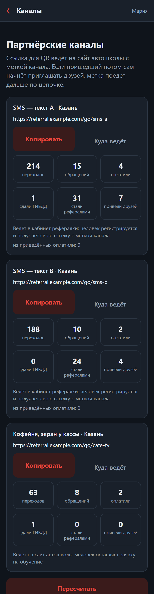

# Реферальный портал автошколы

**Рабочий PWA-сервис для реферальной программы: личные ссылки, статусы приглашённых, выплаты и автоматизация CRM.**

**Статус:** коммерческий проект в эксплуатации · **Формат:** обезличенная публичная копия · **Стек:** PHP 8.2, JavaScript, SQLite, PostgreSQL, Битрикс24 REST, Web Push.

## Задача и результат

Реферальная программа раньше работала через чат-боты Telegram и MAX. Для участников и сотрудников был создан отдельный портал: пользователь получает ссылку, отслеживает приглашённых друзей и оформляет заявку на вознаграждение, а администраторы управляют каналами и видят статистику программы.

Портал связывает пользовательский интерфейс с CRM и учётной системой автошколы. Рутинные проверки и создание задач выполняются автоматически.

**Что важно в реализации:**
- **CRM-синхронизация:** Битрикс24 сообщает об изменениях через вебхуки; фоновая синхронизация каждые 15 минут подстраховывает пропущенные события.
- **Выплаты:** заявка создаёт сделку и задачу бухгалтеру; данные участника проверяются через API учётной системы с ограничением частоты запросов.
- **Аналитика:** каналы привлечения, переходы, регистрации, оплаты, когорты и прогноз бюджета.
- **Надёжность и контроль:** фильтрация переходов роботов, поиск подозрительных заявок, журнал событий в PostgreSQL.
- **Пользовательский опыт:** подтверждение входа звонком, PWA и Web Push-уведомления.

## Как устроено

```text
Участник / администратор
          |
      PWA (JavaScript)
          |
     PHP API + SQLite
       |          |
   Битрикс24   PostgreSQL
  сделки/задачи  события
       |
 Учётная система автошколы
       |
 Очередь проверок с лимитом API

Вебхуки CRM + cron (каждые 15 минут)
для резервной синхронизации
```

> Публичная версия проекта обезличена: названия, домены, телефоны и ключи заменены или удалены. Скриншоты используют вымышленные данные.

## Скриншоты

Экраны на вымышленных данных.

<table>
  <tr>
    <td align="center"><br>Вход по номеру, код звонком</td>
    <td align="center"><br>Кабинет: ссылка и статусы друзей</td>
  </tr>
  <tr>
    <td align="center"><br>Заявка на вознаграждение</td>
    <td align="center"><br>Админка: каналы и A/B-тест SMS</td>
  </tr>
</table>

## Что умеет

**Для участника**
- Вход по номеру телефона, код подтверждения приходит звонком (последние 4 цифры номера).
- Личная ссылка и короткий код, кнопки «Поделиться» и «Копировать», счётчик переходов.
- Список друзей со статусами: заявка → оплатил → в ГИБДД → выплата → получено.
- Заявка на вознаграждение: на карту (с удержанием НДФЛ) или в счёт долга за обучение. Анкета с проверкой паспорта, ИНН, СНИЛС и реквизитов. Заявку можно исправить в течение 30 минут.
- «Это мой друг»: если друг записался без ссылки, участник может заявить его, менеджер подтвердит.
- Push-уведомления о смене статуса друга и о выплате.

**Для администраторов**
- Сводка программы: бюджет, когорты по месяцу прихода друга, прогноз выплат.
- Партнёрские и рекламные каналы (`/go/код`): QR на сертификатах, SMS-рассылки, A/B-тест текстов. По каждому каналу видно, сколько людей перешли, зарегистрировались, привели друзей и сколько из друзей оплатили.
- Персональные ссылки менеджеров: кто привёл участника, тот и становится ответственным в CRM.
- Поиск подозрительных заявок: самоприглашения, повторы, общие реквизиты (`fraudscan.php`).

**Автоматика**
- Синхронизация с Битрикс24: входящий вебхук на смену стадии и подстраховочный проход по крону каждые 15 минут.
- Заявка на выплату создаёт сделку и задачу бухгалтеру в CRM.
- Перед выплатой реферер проверяется в учётной системе школы: учится ли он, номер договора. Проверка идёт через очередь с лимитом запросов, чтобы не нагружать чужой API, а результат ставится в название задачи и в карточку реферера.
- Переходы роботов не считаются: сканеры, превью ссылок в мессенджерах, частые переходы с одного адреса.
- Журнал событий в PostgreSQL: кто что сделал и чем закончилось.

## Стек

- PHP 8.2 без фреймворков, SQLite (данные приложения), PostgreSQL (журнал событий).
- Фронтенд: ванильный JavaScript, свой микрохелпер `h()` для DOM, без сборки.
- PWA: service worker, установка на экран, Web Push (VAPID).
- Интеграции: Битрикс24 REST, LeadTeh (чат-боты), zvonok.com (код звонком), Google Sheets, API учётной системы автошколы.
- Сервер: Ubuntu, nginx, php-fpm, cron.

## Структура

```
app/            серверная логика (вне веб-корня)
  config.php    настройки, ключи читаются из app/.env
  lib.php       БД, сессии, вход, Битрикс24, разбор сделок друзей
  payouts.php   заявки на выплату ↔ сделки и задачи в CRM
  accruals.php  начисления и их статусы
  claims.php    «это мой друг» — привязка друга, пришедшего без ссылки
  campaigns.php партнёрские каналы /go/код и их статистика
  ashk.php      проверка реферера в учётной системе школы, очередь с лимитом
  stats.php     бюджет, когорты, прогноз
  push.php      Web Push
  events.php    журнал событий
  sync.php      крон: синхронизация с CRM, очередь проверок
  schema.sql    схема SQLite
public/         веб-корень
  index.php     роутер: короткие ссылки, API, вход
  app.js        SPA кабинета и админки
  sw.js         service worker
```

## Запуск

1. PHP 8.2+ с расширениями `pdo_sqlite`, `pdo_pgsql`, `curl`, `openssl`, `mbstring`.
2. Скопируйте `env.example` в `app/.env` и заполните ключи.
3. Веб-корень — `public/`, все запросы, кроме статики, идут на `public/index.php`.
4. Папка `app/data/` должна быть доступна PHP на запись: там создаётся база.
5. Крон: `*/15 * * * * php /path/to/app/sync.php`.
6. Для проверки реферера (необязательно) — `app/ashk.env` с `ASHK_API_URL` и `ASHK_API_KEY`. Без файла проверка просто выключена.
